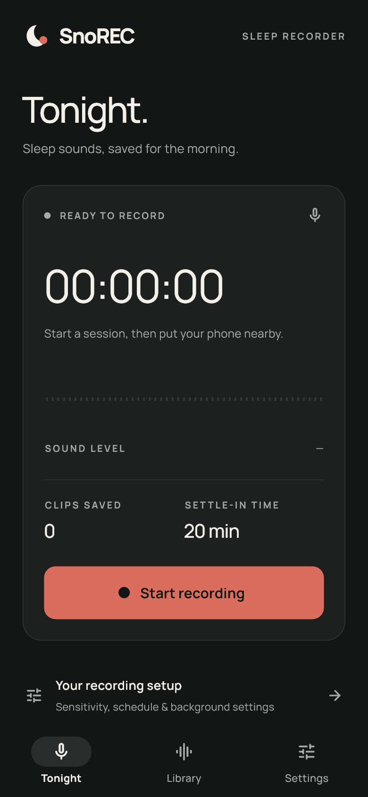
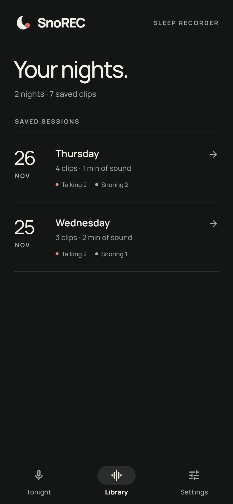
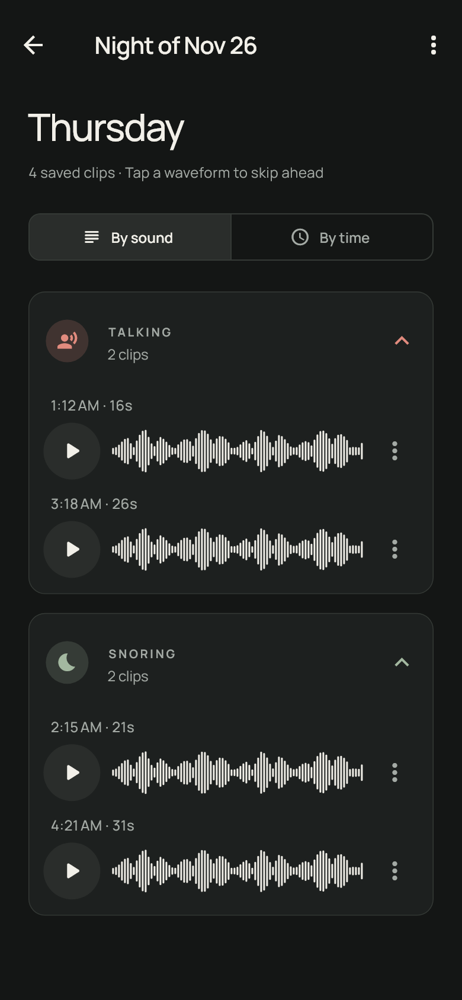

# SnoREC

A quiet place for the sounds you sleep through.

SnoREC records short clips of sleep talking, snoring, and other nighttime sounds.
In the morning, browse your nights, play the clips, and share the ones you choose.
Recording, sound classification, and storage happen on your phone.

**[Download SnoREC for Android](https://github.com/Shen-lon/SnoREC/releases/download/v1.0.0/SnoREC-1.0.0-arm64.apk)**
· [Release notes & checksum](https://github.com/Shen-lon/SnoREC/releases/tag/v1.0.0)

<p>
  
  
  
</p>

Screenshots are rendered from the app with sample data.

## Inside the app

- **Tonight:** one recording control, session timer, live sound level, and clip count.
- **Library:** nights in date order, with clips grouped by sound or time.
- **Playback:** tap or drag a waveform, pause, share, or delete a clip.
- **Settings:** sensitivity, time to fall asleep, clip length, and bedtime reminders.
- **A quieter interface:** charcoal surfaces, warm white type, and a single record accent.
- **Foldable support:** bottom navigation on a phone, side navigation on a wider display.

SnoREC saves audio; it does not turn speech into written transcripts.

## Install

Download the APK from Releases and open it on an ARM64 Android phone running
Android 7.0 or newer. Allow installation from the app you downloaded it with if
Android asks. Grant microphone and notification permissions when prompted.

The application ID is `dev.shenlon.snorec`. This is a separate installation;
recordings and settings from other apps are not imported.

## Before the first night

1. Open **Settings → Background** and allow unrestricted battery use.
2. On HONOR, find **App launch** in the phone's system settings, select SnoREC,
   switch to manual management, and allow **Run in background**. Menu names vary.
3. Start a session in SnoREC, then lock the screen. Keep the microphone clear.
4. First try a short session with the settle-in time at zero and check playback.

Recording uses a microphone foreground service and a CPU wake lock while allowing
the display to turn off. A force stop, powered-off phone, or manufacturer process
cleanup can still end recording. Overnight operation on an HONOR Magic V5 has not
yet been verified on hardware.

Scheduled recording uses a tappable bedtime reminder and an automatic end time.
Reopen the app after restarting your phone to rearm reminders.

## Build

Use Flutter 3.38.5 / Dart 3.10.4, JDK 17, and the Android SDK.

```sh
flutter pub get
flutter analyze --no-pub
flutter test --no-pub
flutter build apk --release --target-platform android-arm64
```

The APK is written to `build/app/outputs/flutter-apk/app-release.apk`.
Without a private `android/key.properties` file, local builds use a development
key. Published releases use a separate SnoREC release key. Future updates must
use the same signing key; never commit signing credentials or keystores.

For a release signing key, provide these local properties:

```properties
storeFile=/absolute/path/to/your-release-key.p12
storePassword=YOUR_LOCAL_PASSWORD
keyAlias=snorec
keyPassword=YOUR_LOCAL_PASSWORD
```

Run native service checks from `android`:

```sh
./gradlew :app:testReleaseUnitTest -Ptarget-platform=android-arm64
```

## Design assets

The launcher and in-app mark share the vector geometry in `lib/widgets/brand.dart`.
To regenerate the standard, adaptive, and monochrome icons:

```sh
flutter test tool/render_brand.dart
dart run flutter_launcher_icons
```

To refresh the UI previews with sample data:

```sh
flutter test --dart-define=UPDATE_SCREENSHOTS=true test/ui_test.dart
```

## Privacy

There is no account, cloud recording, or automatic upload. Clips stay in the
app's local storage until you delete or explicitly share them. Sharing uses
the phone's system share sheet.
